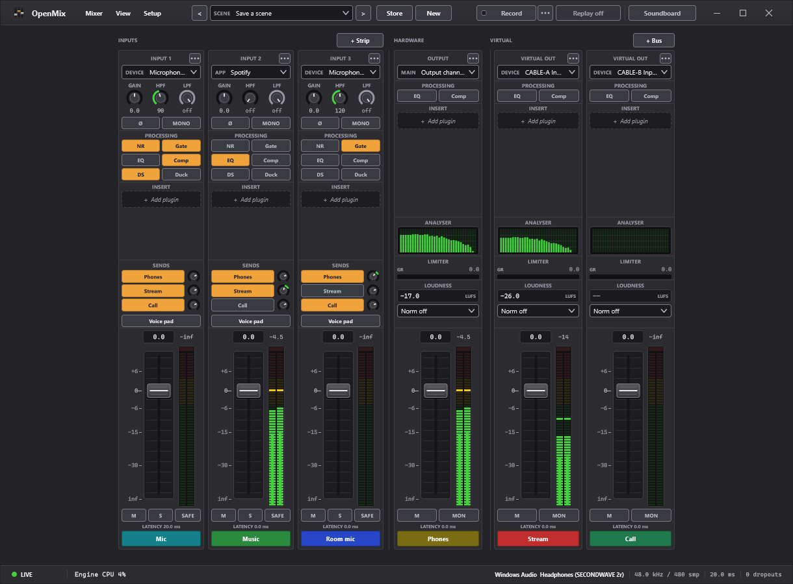

# OpenMix

A free, open-source audio mixer for Windows. Put your mic, other devices, single apps
(Spotify, a game, Discord) or everything an output device plays on their own strips, clean
them up, and send a separate mix to your headphones, the stream and the call.



- **Inputs:** up to 8 strips. Each takes a channel or stereo pair of the main device
  (ASIO, WASAPI or DirectSound), any other Windows input, one app's audio, a loopback of
  a Windows output device, or the built-in media player.
- **Voice processing built in:** RNNoise and DeepFilterNet 3 noise removal, gate, high- and low-pass filters,
  8-band EQ, compressor, de-esser and ducking on every strip, plus a voice pad (XY pad with
  voice, pan, colour and space modes).
- **VST3 plugins** on every strip and bus: 6 slots each, crash-safe scanning and loading,
  out-of-process audio rendering, bypass without clicks, wet/dry, A/B compare, presets and
  latency compensation. Editors stay in the app; a duplicate instance renders each chain in
  a worker with a two-callback audio pipeline.
- **Outputs:** up to 6 buses (A1-A3 hardware, B1-B3 virtual), each to an output pair of the
  main device or to any Windows output device, with EQ, compressor, plugins and a safety
  limiter. Buses are grouped **Hardware** / **Virtual** on the desk, and each bus can have a
  custom name (its group never changes when you rename it).
- **A desk of narrow columns:** every strip and bus uses the same sections, knobs for gain,
  filters and send levels, one aligned fader bay, and a coloured name plate at the bottom.
- **Creator tools:** multitrack recorder, replay buffer, soundboard, spectrum and LUFS
  loudness on every bus.
- **Scenes and global hotkeys:** save whole mixes and switch between them; mute, push to
  talk, soundboard, recording and scenes on hotkeys that work while a game has focus.
- **Control:** keyboard throughout, OSC, a phone/browser remote with a WebSocket API, MIDI
  controller mapping, tray icon, start with Windows.

Built with C++20 and JUCE 9.0.5. Licensed under the GNU AGPLv3.

**Documentation:** the [OpenMix wiki](https://itzcaesar.github.io/OpenMix/docs/) covers getting started, strips, buses, plugins, remote control, scenes and hotkeys, troubleshooting, the changelog and the roadmap.

## Download

Every push to `main` is built by GitHub Actions: open the latest run under **Actions** and
download `OpenMix-windows-x64`. Version tags (for example `v0.1.0`) also publish a GitHub
release with the zip and an installer, `OpenMix-<version>-setup.exe`.

Full user guide: [OpenMix wiki](https://itzcaesar.github.io/OpenMix/docs/).

## Build it yourself

Requirements: Windows 10 2004 or later, Visual Studio 2026 with the **Desktop development
with C++** workload (it includes CMake), and the stable Rust toolchain (Cargo builds the
DeepFilterNet runtime). Clone with submodules (JUCE and RNNoise):

```powershell
git clone --recursive https://github.com/itzcaesar/OpenMix.git
```

**In Visual Studio:** File > Open > Folder, pick the `vs2026` preset, set the startup item to
`OpenMix.exe`, press F5.

**From a Developer PowerShell for VS 2026:**

```powershell
cmake --preset vs2026
cmake --build --preset release
ctest --test-dir build -C Release
.\build\OpenMix_artefacts\Release\OpenMix.exe
```

## Quick start: mic to Discord, music to your headphones

1. Click the **device readout** on the right of the bottom bar (or **Setup > Audio device**)
   and choose your audio device. ASIO gives the lowest latency; Windows Audio works with
   anything.
2. On **Input 1**, open the source picker and choose your mic. Switch on **NR** to remove
   background noise, and turn **HPF** up to about 100 Hz.
3. On **Input 2**, choose **Application audio** and pick Spotify (or a game).
4. Bus **A1** is what you hear: point its output at your headphones.
5. Bus **B1** is for apps that need a microphone: point it at a virtual cable (for example
   VB-Audio Virtual Cable's "CABLE Input"), then choose the cable's other end ("CABLE
   Output") as the microphone in Discord or OBS.
6. On each strip, the **SENDS** keys decide where it goes and the knobs beside them how loud:
   mic on A1 and B1, music on A1 only (or on B1 too, if the call should hear it).

Everything is saved automatically.

## The window

- **Header:** OpenMix, the **Mixer**, **View** and **Setup** menus, the scene stepper
  (**<**, the scene picker, **>**, **Store**, **New**), **Record** and its options,
  **Replay**, **Soundboard** (shows or hides the soundboard bar), and the window buttons.
  The header is the title bar: drag it to move the window, double-click it to maximise.
  **Settings** is in the Setup menu.
- **Inputs** on the left, **buses** on the right. **+ Strip** and **+ Bus** sit next to the
  section names. Buses are grouped **Hardware** (A1-A3) and **Virtual** (B1-B3) with a
  divider between them; **+ Bus** asks for the group first, then an optional custom name,
  and takes the next free slot in that group.
- Every strip and bus ends in the same **fader bay**, so faders, meters and keys line up
  across the desk. The number above each meter is the held peak; a red bar under it marks
  0 dBFS or more.
- The **bottom bar** shows LIVE, the engine's own CPU%, plugin scanning and recording
  progress, a lamp for each remote you switched on (OSC, phone, MIDI), and on the right the
  audio device, sample rate, buffer, latency and dropouts (click it for Audio settings).
- The **soundboard** is a bar under the desk.
- A warning banner appears if the main device's input and output are two different Windows
  devices, because their clocks drift and that crackles. The banner explains the fix.
- **Colour means state:** amber for a key that is on, red for mute and clipping, yellow for
  solo, green for level (knob rings, meters). Panels stay neutral grey.

## Strips

Every strip is the same narrow column, top to bottom in the order the audio flows: INPUT,
PROCESSING, INSERT, SENDS, the **Voice pad** button, then the fader bay.

1. **Input:** **INPUT n** with the three-dot menu (rename, colour, mono, invert polarity,
   solo-safe, strip presets, remove), the **source** picker, then three knobs: **GAIN**
   (-24 to +24 dB), **HPF** (20 Hz to 1 kHz, all the way left is off) and **LPF** (1 to
   20 kHz, all the way right is off). The value under each knob shows the setting or "off".
   **Ø** inverts the polarity, **MONO** sums to mono. Sources:
   - **Main device:** one channel (spread to stereo) or a **stereo pair**.
   - **Windows input device:** any other mic or capture device, alongside the main device.
   - **Application audio:** one app's sound, using Windows' per-process loopback. If the
     app isn't playing or quits, the picker says "(not running)" and the strip reconnects
     when it starts again. **App's own output** (in the same menu) moves the app's direct
     sound to a device you don't listen to, so you only hear it through OpenMix; it goes back
     to normal when the strip's source changes or OpenMix quits.
   - **Windows output (loopback):** everything one output device plays, without a virtual
     cable. Devices OpenMix itself plays into are greyed out, because capturing them would
     feed the sound back into itself.
   - **Media player:** the built-in playlist player (see [Media player](#media-player)).
2. **Processing** keys in two columns, amber when on. Click for settings, Space switches
   on or off.
   - **NR** noise removal: choose lightweight RNNoise or higher-quality DeepFilterNet 3.
     DeepFilterNet adds about 100 ms at 48 kHz and uses more CPU; other strips are delayed to
     match. Its model weights are not bundled. Use **Download** in the NR panel to fetch and
     verify the pinned official `DeepFilterNet3_onnx.tar.gz` archive; **Install...** imports a
     local copy. The model
     is stored in `%APPDATA%\OpenMix\Models` and the choice is saved per strip.
   - **Gate** turns the strip down while it's quiet. **EQ**: 8 bands (a low shelf, six bells
     with gain, frequency and width, a high shelf) plus the HPF and LPF. **Comp** evens out loud and quiet parts. **DS** softens
     harsh S sounds. **Duck** lowers this strip while another strip has signal (music under
     your voice).
   - Gate, compressor, de-esser and ducking show a gain-reduction meter in their panel.
3. **Insert:** up to 6 VST3 plugins, see [Plugins](#plugins).
4. **Sends:** one row per active bus, a key with the bus's name and a level knob.
   - The key switches the send; the knob sets its level (double-click or Home for 0 dB).
     Right-click the key (or M) for **pre-fader** (the send ignores the strip fader, for
     example a separate mix for a call); a pre-fader send shows "P".
5. **Voice pad** opens the strip's XY pad in a popup (double-click or Home resets the puck):
   - *Voice*: X = tone tilt from Lo (full) to Hi (bright), about +/-9 dB. Y: the lower half
     adds presence and air, the upper half a doubler, with a little reverb near the top.
   - *Pan*: X = constant-power pan, Y = stereo width (100-200%).
   - *Color*: corners Warm, Bright, Radio and Close; the puck blends them.
   - *Space*: X = pan, Y = distance (quieter, darker, with early reflections).
6. **Fader bay:** fader and meter, then **M** (mute, red), **S** (solo, yellow) and **SAFE**
   (solo-safe), the strip's **LATENCY**, and the **name plate** (double-click, Enter or F2
   to rename).
   - **Solo** plays the strip alone on the **monitor bus** (the bus with **MON** lit).
     **SAFE** keeps the strip playing on the monitor bus while another strip is soloed.
     Stream and call buses are not affected.
   - **LATENCY** is this strip's own delay (noise removal plus plugins). Every strip is
     delayed to match the slowest one, so sends stay aligned.

A **strip preset** (three-dot menu) saves the strip's sound under a name and recalls it on
this strip or any other. It carries gain, fader, filters, processing, inserts, sends and the
voice pad, and never the name, source, mute or solo state. If a preset's plugins are missing
on recall (or are on the crash skip list), those slots are skipped and you are told how
many. Open plugin windows on the strip close first. A preset does not store plugin state,
and a preset never makes a strip duck under itself.

Signal path: gain, polarity/mono, DC blocker, noise removal, gate, HPF/LPF, EQ, compressor,
de-esser, inserts, voice pad, ducking, latency alignment, mute, fader, sends.

## Plugins

"+ Add plugin" lists the VST3 plugins in `C:\Program Files\Common Files\VST3`, grouped by
maker when there are many. They are scanned in the background, each in its own process, so
a plugin that crashes while being scanned is skipped instead of taking OpenMix down
(Settings > Retry skipped plugins tries them again). A plugin that only takes too long, or
is still being scanned when you quit, is scanned again next time instead.

- Click a plugin to open its window; its lamp bypasses it (with a short crossfade, and its
  latency kept so timing doesn't jump).
- Drag a plugin up or down to reorder the chain (or Alt+Up/Down).
- The dots menu: **Wet/dry mix** (the dry signal is delayed to match the plugin's latency),
  **A/B compare** (two settings to switch between; the row shows "(B)" while you hear B),
  save or load a **preset** (`.omxpreset`), replace, remove.
- A plugin that outputs invalid audio (NaN/Inf) is stopped automatically and marked, instead
  of breaking the mix. "Try again" in its menu restarts it.
- **Crash-safe loading** (on by default, Settings): before a plugin is loaded into the mixer,
  it is started in a separate test process: created, prepared and run through one silent
  block. A plugin that crashes there is skipped and put on the skip list instead of taking
  OpenMix down (Settings > Retry skipped plugins tries it again). A plugin that is only slow
  to start (over 30 s, for example a licence window) is not skipped: you're asked whether to
  load it anyway. Audio rendering happens in a child worker. If a plugin crashes or stalls
  while processing, OpenMix disables that slot, restarts the worker, and uses latency-matched
  dry audio while the worker is unavailable. The editor/control instance stays in the app.

### VST2 plugins (opt-in, local build only)

VST2 hosting is **off by default** and is not in the released builds. JUCE 9 still
contains the VST2 host code, but it needs `aeffect.h` / `aeffectx.h` from the VST2 SDK,
which JUCE no longer bundles, and Steinberg stopped issuing new VST2 licences in
October 2018, so a new developer cannot legally distribute a VST2 host. Only enable
this if you already hold a VST2 licence and SDK. The SDK is never committed to this
repo, never fetched by CMake, and CI builds with VST2 off.

To build with it, from a Developer PowerShell for VS 2026:

```powershell
cmake --preset vs2026 -DOPENMIX_ENABLE_VST2=ON -DVST2_SDK_DIR="C:/SDKs/vstsdk2.4"
cmake --build --preset release
```

`VST2_SDK_DIR` must be the SDK folder containing `pluginterfaces/vst2.x/aeffect.h`
(from `vstsdk3610_11_06_2018_build_37` or older). With it on, OpenMix also scans
the usual VST2 locations (`C:\Program Files\Steinberg\VstPlugins`,
`C:\Program Files\VstPlugins`, and the `VST_PATH` environment variable) for `.dll`
plugins, in the same crash-safe child process as VST3. VST2 plugins then appear in
"+ Add plugin" alongside VST3 ones and use the same slots, bypass, wet/dry, presets
and latency compensation. Session files already store the plugin's format, so a
session saved with a VST2 plugin loads it back when built with VST2 on; that slot is
empty on a default (VST2-off) build.

## Buses

- **Output:** an output pair of the main device, any Windows output device, or **Not connected**
  (internal only, still available to recording and replay). Each bus can use a different device:
  A1 headphones, A2 speakers, B1 a virtual cable for Discord or OBS. Extra devices run on their
  own clocks; OpenMix resamples them and corrects the drift, which adds about 10-25 ms on those
  devices only. Adding buses does not require separate drivers per bus; only exposing a B bus
  as a microphone to other apps needs a virtual endpoint (a virtual cable today, or one
  multi-endpoint OpenMix driver in Phase 7; see `docs/VIRTUAL_DRIVER.md`).
- **Custom names:** rename a bus from its three-dot menu (empty = the default A1..A3 /
  B1..B3). The name is shown on the bus's name plate, on the strips' send keys, in the soundboard
  and in recording. A bus never changes group when renamed: slots A1-A3 are always
  **Hardware**, B1-B3 always **Virtual**.
- **LIMITER:** the gain reduction of the safety limiter (-0.3 dBFS ceiling), as a number and
  a bar; it reads "LIMITING" in red while the limiter works hard. **MON** is lit on the
  **monitor bus**, where soloed strips are heard; click MON on another bus to move it there.
  **Loudness** is the short-term LUFS (the number streaming
  platforms normalise to), with the normalisation target and gain when normalisation is on. The bus strip shows the live spectrum only; the full analyser
  (see below) has the momentary and integrated numbers.
- **Meters** show peak (the LED ladder) and RMS (the solid bar inside it): peak catches
  transients, RMS shows how loud the bus actually sounds. The same RMS bar is on every
  strip and on the soundboard.
- **Loudness normalisation** (the box under the LUFS readout, or the bus's three-dot menu): a
  slow gain that pulls the bus towards
  -14 LUFS (streaming), -16 or -23 (broadcast), clamped to +/-12 dB and smoothed so it never
  pumps on a drum hit. It measures the bus the way the LUFS readout does (K-weighted, about a
  3 s window), so the target and the readout agree. It sits before the bus fader, so the
  fader still turns the result up or down. It holds its gain in silence instead of turning
  the noise floor up, and glides back to unity when you switch it off. It is saved with the
  session and with scenes.
- **EQ** and **Comp** keys and up to 6 **inserts**, the same as on a strip (EQ and Comp fade
  in and out instead of clicking). Bus path: sum, EQ, compressor, inserts, loudness
  normalisation, fader, safety limiter.
- **Analyser:** a live spectrum on the bus column. Click it for the full **analyser**: spectrum plus
  momentary, short-term and integrated loudness.
- The three-dot menu: rename the bus, analyser, loudness normalisation, monitor bus (where
  solo plays), remove the bus.
- **Routing matrix** (Mixer menu): every strip and bus down the side, every bus across the top.
  A cell's key turns the send on and its knob sets the level. Strip rows are the strips' own
  sends. A bus row feeds that bus, after its fader and limiter, into another bus, for example
  B1 (the stream mix) into A1 so you hear it. A feed that would make a loop is greyed out.
  While something is soloed, feeds into the monitor bus pause.

## Recording and replay

- **Record** (Ctrl+Shift+R) writes every bus, every strip, or both, to one WAV file each in
  `Documents\OpenMix Recordings\<date and time>` (a second take in the same second gets its
  own folder). While recording, the button shows the elapsed time. Changing the sample rate
  in Audio settings stops the recording, so the files never play back at the wrong speed.
- The dots next to Record choose what to record, set the **replay buffer** and open the
  recordings folder.
- **Replay buffer:** keeps the last 30, 60 or 120 seconds of one bus in memory. **Replay**
  (Ctrl+Shift+S) saves them as a WAV file; saving twice never overwrites the first.

## Soundboard

A bar along the bottom of the window (the header's **Soundboard** button shows or hides it).

- 32 pads for WAV, MP3, FLAC or Ogg files up to 60 seconds, in four pages (**A**-**D**) of 8.
  Click a pad, or press 1-8 anywhere in OpenMix, to play the page shown. Pads fire as soon as
  you press. A page key shows a dot while one of its pads plays on another page.
- Drop audio files on a pad to load it (several files fill the following pads), or anywhere
  on the bar to fill the page's empty pads.
- Right-click a pad (or M) to load, rename, clear, or set its:
  - **Volume** (before the soundboard volume);
  - **Mode:** *Play once* (press again to stop, with a short fade), *Restart* (press again to
    start over), *Loop* (until pressed again) or *Hold to play* (plays while the pad, its key
    or its hotkey is held);
  - **Colour** (the bar along the bottom of the pad).
- While a pad plays, its bottom bar shows how far it has got.
- Its own volume and meter, and **Play on** keys for the buses it plays on (A1 and B1 by
  default, so you and your stream both hear it). **Stop all** stops every pad.

## Media player

**View > Media player** opens a playlist player. Pick **Media player** as a strip's source
(the strip's source menu) to hear it: that strip's EQ, compressor, ducking (under your mic)
and sends all apply, so music can go to the stream at one level and your headphones at another.

- Add WAV, MP3, FLAC, Ogg or AIFF files with **+ Add files** or by dropping them on the window.
  Files are streamed from disk, so a two-hour mix is fine.
- Play/pause (or Space), previous, next, a position bar to seek, **Repeat** (all, one, off)
  and **Shuffle**. Double-click or Enter plays a track; Delete removes it.
- The playlist, the current track, repeat and shuffle are saved with the session. It comes back
  paused.

## Scenes

A scene is a saved mix: strip and bus levels, mutes, solos, sends (on, level, pre-fader),
processing settings, plugin bypass and wet/dry, the voice pad, bus EQ and compressor, and
the soundboard's level and buses. Sources, devices and the plugins themselves are not part
of a scene, so switching is instant, and every level glides to its new value without a
click.

The scene stepper in the header switches scenes: **<** and **>** step through them, the
picker lists them, **Store** saves the current mix into the selected scene and **New** saves
it as a new one. The picker's menu also renames or deletes scenes and opens Hotkeys. Deleting a scene moves the hotkeys and MIDI buttons of later scenes up with
them. Scenes are saved with the session. Over OSC, `/openmix/scene/<n>` switches to
scene n (counting from 1).

## Global hotkeys

**Setup > Hotkeys** (also in the Mixer menu, the scene menu and Settings). These work in any app, also
while a game is in front, and the keys still reach that app, so pick combinations it doesn't
use (for example with Ctrl+Alt).

- **+ Add hotkey**, pick what it does, then press the keys (Escape cancels). Click a
  hotkey's keys to change them; **Remove** deletes it. A combination can only be used once.
- Actions: mute or unmute a strip, **push to talk** on a strip (open while you hold the keys,
  muted when you let go), play a soundboard pad, stop all sounds, start or stop recording,
  save the replay, switch to a scene.
- Keys sent by other software (macro tools, remote desktop) are ignored on purpose.

## Settings

**Setup > Settings**: light or dark theme, compact mode, hotkeys, start with Windows, start minimized, keep running in the tray when the
window closes, plugin scanning and crash-safe loading, presets and VST3 folders, the update check, OSC,
phone / WebSocket and MIDI remote control, and the log folder. In the tray, double-click opens the mixer; right-click to quit.

The **update check** is off by default. When on, OpenMix asks GitHub once at startup
whether a newer release exists and, if so, shows an Update button that opens the release
page. It doesn't download or install anything.

## Remote control (OSC, phone, MIDI, Stream Deck)

All three remotes speak the same paths, so a fader moved from a phone, a MIDI knob or a
Stream Deck does exactly what the same OSC address does. They are off by default (Settings);
while one is on, anyone on your network can control the mixer, so only turn them on at home
or on a network you trust. There is no password: the LAN is the trust boundary. Web pages
are a different matter: the phone remote refuses any browser request that comes from
another website, so a page you have open can't reach the mixer through `localhost`.

### Phone / browser remote and WebSocket API

Settings > "Phone / browser remote and WebSocket API" (TCP port 8080 unless you change it).
Open `http://<this PC>:8080/` on your phone: faders, mutes, soundboard pads and scenes, live
over the WebSocket (changes made in the app, from MIDI or from another phone show up too),
with HTTP polling as a fallback if the WebSocket can't connect.

The same port is the API:

- `GET /api/state`: the mixer's state as JSON (strips, buses, soundboard, scenes, recording).
- `POST /api/command` with `{"path": "/openmix/strip/1/fader", "value": -6}`: one command.
- `ws://<this PC>:8080/ws`: send `{"path": ..., "value": ...}`, receive
  `{"type": "state", "state": {...}}` whenever the mix changes, plus `{"type": "ok"}` or
  `{"type": "error", ...}` for each command.

### OSC

Off by default (Settings). While it's on, OpenMix listens on a UDP port (9000 unless you
change it) and anything on your network can control it, so only turn it on at home or on a
network you trust. Values are dB unless noted (out-of-range values are clamped, NaN and
infinity are ignored); strips and pads count from 1.

| Address | Argument |
|---|---|
| `/openmix/strip/<n>/fader`, `/gain` | dB |
| `/openmix/strip/<n>/mute`, `/solo` | 0 or 1 |
| `/openmix/strip/<n>/send/<bus>` | 0 or 1 (bus name, e.g. `B1`) |
| `/openmix/strip/<n>/sendlevel/<bus>` | dB |
| `/openmix/bus/<bus>/fader` | dB |
| `/openmix/bus/<bus>/mute` | 0 or 1 |
| `/openmix/bus/<bus>/norm` | 0 or 1 (loudness normalisation on/off) |
| `/openmix/soundboard/<n>/play` | none (plays or stops pad n) |
| `/openmix/record` | 1 starts, 0 stops |
| `/openmix/replay/save` | none |
| `/openmix/scene/<n>` | none (switches to scene n) |

### MIDI controllers

Settings > "MIDI controller": pick a device, then pick a target, press **Learn...**, and
move a knob or press a key on the controller. Targets: each strip's fader, gain, mute, solo,
send on/off and send level per bus; each bus's fader, mute and loudness normalisation;
soundboard pads, Record, Save replay and scenes 1-8.

- A CC moves a fader, gain or send level across its range.
- A note, or a CC crossing the middle (64) upwards, toggles a mute, solo, send or
  normalisation. It flips whatever the mixer has now, so it stays in step with changes made
  in the app. It also plays a pad, starts or stops recording, saves the replay or switches
  scene.
- A learned mapping is saved straight away. If the controller is unplugged, OpenMix opens it
  again when it's back.

### Stream Deck

There is no native OpenMix Stream Deck plugin. Use the Stream Deck software's OSC plugin
with the addresses above, or a WebSocket plugin against the phone-remote port; both speak
the same paths, so a button that sends `/openmix/strip/1/mute` with 1 works either way.

## Keyboard

Tab and Shift+Tab move through the header, then each strip top to bottom, then the buses.

| Control | Keys |
|---|---|
| Faders, gain knob | Up/Down 1 dB (Shift: 0.1 dB), Page Up/Down 6 dB, Home 0 dB |
| Voice pad | Arrow keys move the puck (Shift: fine), Home resets |
| Plugin row | Enter open/add, Space bypass, Delete remove, Alt+Up/Down move, M menu |
| Processing key | Enter opens settings, Space switches on/off |
| Send key | Enter or Space switches, M or Shift+Enter opens level and pre-fader |
| Name plate | Enter or F2 rename |
| Meter | Enter resets the clip lamp |
| Spectrum | Enter or Space opens the analyser |
| Buttons and pickers | Enter or Space |
| Record, save replay | Ctrl+Shift+R, Ctrl+Shift+S |
| Undo, redo a mix change | Ctrl+Z, Ctrl+Y (or Ctrl+Shift+Z) |
| Soundboard pads | 1-8 while the soundboard is shown; M opens a focused pad's menu |

These shortcuts work while OpenMix has focus. For keys that work in any app, set up
[global hotkeys](#global-hotkeys).

## Where things are saved

| What | Where |
|---|---|
| Session (devices, theme, strips, plugins and their settings, buses, soundboard) | `%APPDATA%\OpenMix\session.xml`, every 10 seconds (plugin state at most once a minute) and on exit |
| Scenes | inside the session |
| App settings (startup, tray, OSC, phone/WebSocket, MIDI, hotkeys, recording options) | `%APPDATA%\OpenMix\settings.xml` |
| Log and crash reports | `%APPDATA%\OpenMix\openmix.log`, `crash-<time>.txt` |
| Recordings and replays | `Documents\OpenMix Recordings` |
| Plugin presets | `Documents\OpenMix Presets` |

## Reliability

- **Audio thread:** no allocation, no blocking locks, no I/O. Every UI change is an atomic,
  smoothed per sample. Denormals are flushed.
- **Safety limiter** on every bus protects ears, speakers and apps fed by virtual buses.
- **NaN/Inf guard** on every plugin, and a last guard on every strip.
- **DC blocker** (5 Hz) on every input; click-free plugin bypass and enable.
- **Latency compensation:** every strip is delayed to match the slowest one (plugins and
  noise removal), and a bypassed plugin keeps its latency, so strips that meet on a bus stay
  in time.
- **Crash-safe plugin scanning** in separate processes, and **crash-safe plugin loading**:
  a plugin is started in a test process before it is loaded into the mixer.
- **Reconnects by itself:** extra devices, app captures and loopbacks come back after
  unplugging, stalls or Windows audio changes (checked every 2 seconds).
- **Safe start:** if a plugin crashes OpenMix while a session loads, the next start skips
  plugins and keeps a copy of the session in `session-before-crash.xml`.
- **Crash report and log** in `%APPDATA%\OpenMix` (Settings > Open log folder).
- **Core tests** (`ctest`, no JUCE needed): clock drift and jitter, resampling pitch,
  limiter, NaN detection, DC blocker, filter stability, dynamics, denoiser latency at 44.1
  and 48 kHz, the EBU loudness reference, RMS metering and loudness normalisation. App tests
  cover session loading (including old files), scenes, presets, plugin slot moves, sandbox
  worker crash recovery, the remote and MIDI commands, the soundboard and the hotkey thread.
  Both run in CI on every push.

## Project layout

`Source/` is split by job. Includes are written relative to `Source/`
(`#include "engine/MixerEngine.h"`).

| Folder | What's in it |
|---|---|
| `Source/app/` | `Main` (startup, crash report, log), `MainComponent` (window, header, console layout, scenes), `AppSettings`, `Session` (save and restore, scene capture and recall), `GlobalHotkeys` (system-wide keyboard hook), `OscControl`, `RemoteCommands` (one remote language for OSC, WebSocket and MIDI), `RemoteServer` (phone page, HTTP and WebSocket API), `MidiControl` (learnable MIDI mappings), `UpdateChecker` |
| `Source/engine/` | `MixerEngine` (device, real-time callback, strips to buses to outputs), `ChannelStrip` (per-strip DSP), `PluginChain` and `PluginSandbox` (VST3 control instances and out-of-process audio rendering), `VoicePad` (XY pad DSP and its UI), `ClockBridge` (drift-correcting resampler between clocks), `ExternalIO` (extra devices, app and loopback sources), `AppCapture` (app and device loopback capture), `AppRouting` (per-app output device), `PluginScanner` (scanning and crash-safe loading probes in child processes), `StripLogic`, `CpuMeter` |
| `Source/creator/` | `Recorder` and `ReplayBuffer`, `Soundboard`, `MediaPlayer` |
| `Source/dsp/` | Header-only real-time blocks: `Biquad`, `DelayLine`, `AudioSafety` (limiter, NaN guard, DC blocker), `Dynamics` (gate, compressor, EQ, de-esser), `SincTable` (windowed-sinc resampling), `Loudness` (BS.1770 LUFS), `Metering` (RMS meter, K-weighted loudness normaliser); plus `Denoiser` (RNNoise at any sample rate and DeepFilterNet 3 on a worker thread) |
| `Source/ui/` | `Theme` and `OpenMixLookAndFeel` (design tokens, control drawing), `Widgets`, `StripView`, `BusView`, `InsertRack` (insert list, plugin windows, presets, A/B), `Panels` (processor, send, wet/dry and global FX pop-overs), `AnalyserPanel` (analyser and the bus spectrum), `SoundboardPanel`, `SettingsPanel`, `HotkeysPanel`, `TrayIcon` |
| `Source/third_party/rnnoise/` | RNNoise files patched for MSVC |
| `tests/` | `CoreTests.cpp` (DSP, no JUCE), `AppTests.cpp` (engine, remote, MIDI), run via `ctest` |
| `resources/` | App icon: `make_icon.py` draws `icon.png` and `icon.ico` |
| `installer/OpenMix.iss` | Inno Setup installer, built by CI for version tags |
| `docs/` & `website/` | UI design direction (`docs/DESIGN.md`), Phase 7 virtual driver guide (`docs/VIRTUAL_DRIVER.md`), and MkDocs user wiki (`mkdocs.yml`, `website/docs/`) |
| `ROADMAP.md` | What's done and what's next |

## Releases

Push a version tag (for example `git tag v0.1.0` then `git push --tags`). CI builds the app,
runs the tests, and attaches the zip and `OpenMix-<version>-setup.exe` to a GitHub release.

## Known limits

- No virtual audio driver of its own yet, so apps that need a microphone input from OpenMix
  need a virtual cable (VB-Audio Virtual Cable or similar) on a B bus.
- VST3 plugins have to start on the UI thread (a VST3 rule), so a slow plugin can pause the
  window briefly while it opens; its slot shows "Loading..." meanwhile.
- Plugin editors and the control/state instance remain in OpenMix to preserve the existing
  editor workflow. A fault in editor code or another non-rendering plugin call can still
  affect the app. The separate render instance adds memory use and two device callback blocks
  of latency to chains with inserts.
- The phone / WebSocket remote has no password: anyone on the same network can control the
  mixer while it is on. Only enable it on a network you trust.
- Global hotkeys use a keyboard hook that only listens. A game with strict anti-cheat could
  in principle object to any keyboard hook; Discord and OBS use the same mechanism.
  The hook runs on its own thread, so a busy OpenMix never slows typing in other apps.
- "App's own output" uses the same Windows setting as Settings > Sound > Volume mixer. The
  interface behind it is undocumented, so on an unusual Windows build it can report that it's
  unavailable.

## License

OpenMix is licensed under the GNU AGPLv3 (see `LICENSE`). It's built on JUCE, used here
under its AGPLv3 option, and includes RNNoise v0.1.1 (BSD-3-Clause, see
`Source/third_party/rnnoise/COPYING`) and DeepFilterNet `libDF` v0.5.6 (MIT or Apache-2.0,
see `external/DeepFilterNet/LICENSE-MIT` and `LICENSE-APACHE`). DeepFilterNet model weights
are downloaded separately by the user and are not included in OpenMix releases.
