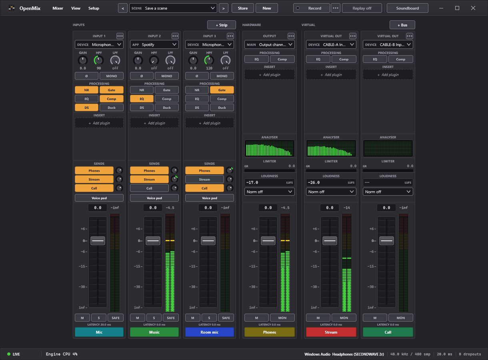

# OpenMix

A free, open-source audio mixer for Windows. Put your mic, other devices,
single apps (Spotify, a game, Discord) or everything an output device plays
on their own strips, clean them up, and send a separate mix to your
headphones, the stream and the call.

{ .desk-shot width="1220" height="900" }

This wiki covers **OpenMix 0.1.0**, the first public release. OpenMix is
written in C++20 with JUCE 9 and licensed under the GNU AGPLv3.

## Quick start: mic to Discord, music to your headphones

1. Click the **device readout** on the right of the bottom bar (or
   **Setup > Audio device**) and choose your audio device. ASIO gives the
   lowest latency; Windows Audio works with anything.
2. On **Input 1**, open the source picker and choose your mic. Switch on
   **NR** to remove background noise, and turn **HPF** up to about 100 Hz.
3. On **Input 2**, choose **Application audio** and pick Spotify or a game.
4. Bus **A1** is what you hear: point its output at your headphones.
5. Bus **B1** is for apps that need a microphone: point it at a virtual
   cable (for example VB-Audio's "CABLE Input"), then pick the cable's
   other end ("CABLE Output") as the microphone in Discord or OBS.
6. On each strip, the **SENDS** keys decide where it goes and the knobs
   beside them how loud: mic on A1 and B1, music on A1 only (or on B1 too,
   if the call should hear it).

Everything is saved automatically.

## Find your way

| You want to | Read |
|---|---|
| Install it, build it, make a first mix | [Getting started](getting-started.md) |
| Pick sources, clean up a voice, set sends | [Strips & voice processing](strips.md) |
| Route to headphones, OBS and Discord | [Buses & outputs](buses.md) |
| Use your VST3 plugins | [Plugins](plugins.md) |
| Control it from a phone, OSC, MIDI or a Stream Deck | [Remote control](remote.md) |
| Switch mixes, use hotkeys, record, play sounds | [Scenes, hotkeys & creator tools](creator.md) |
| Understand the layout and colours | [Interface & themes](interface.md) |
| Check the limits before going live | [Troubleshooting & known limits](troubleshooting.md) |

## Download

Every push to `main` is built by GitHub Actions: open the latest
successful run under **Actions** in the repository and download
`OpenMix-windows-x64`. Version tags will also publish a release with the zip
and an installer on the
[releases page](https://github.com/itzcaesar/OpenMix/releases); the first
is v0.1.0.
